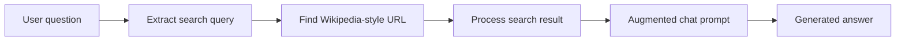

# Chat With Wiki - Azure ML Prompt Flow RAG Demo

Azure ML Prompt Flow demo for retrieval-augmented chat over Wikipedia-style sources.

> Portfolio demo only. Use public or synthetic source text. Do not add private documents, credentials, PHI, PII, or employer-confidential data.

## Problem

Retrieval-augmented generation systems need a clear path from user question to search query, retrieved context, prompt assembly, and answer generation. This repository demonstrates that flow with compact Python scripts and Prompt Flow-style Jinja templates.

## Architecture



## Repository Contents

- `extract_query_from_question.jinja2`: prompt template for extracting a search query.
- `get_wiki_url.py`: URL discovery helper.
- `search_result_from_url.py`: source retrieval helper.
- `process_search_result.py`: retrieved context processing.
- `augmented_chat.jinja2`: answer-generation prompt template with retrieved context.

## Setup

```bash
git clone https://github.com/smgpulse007/ChatWithWiki_AzureML.git
cd ChatWithWiki_AzureML
python -m venv .venv
.\.venv\Scripts\activate
pip install -r requirements.txt
```

If no `requirements.txt` is present, inspect the imports in the Python scripts and install only the packages needed for the path you run.

## Sample Query

```text
What were the main scientific contributions of Marie Curie?
```

Expected flow:

1. Extract a concise search query.
2. Retrieve a public encyclopedia-style page.
3. Build a grounded answer prompt using retrieved context.
4. Return an answer with clear limitations around source coverage.

## Limitations

- This is a compact Prompt Flow/RAG demo, not a hosted production system.
- Source quality depends on the retrieved public page.
- No persistence, evaluation harness, auth, monitoring, or production guardrails are included.

## Portfolio Relevance

Demonstrates Azure ML Prompt Flow-style RAG decomposition, prompt templating, retrieval context handling, and public-safe LLM application structure.
