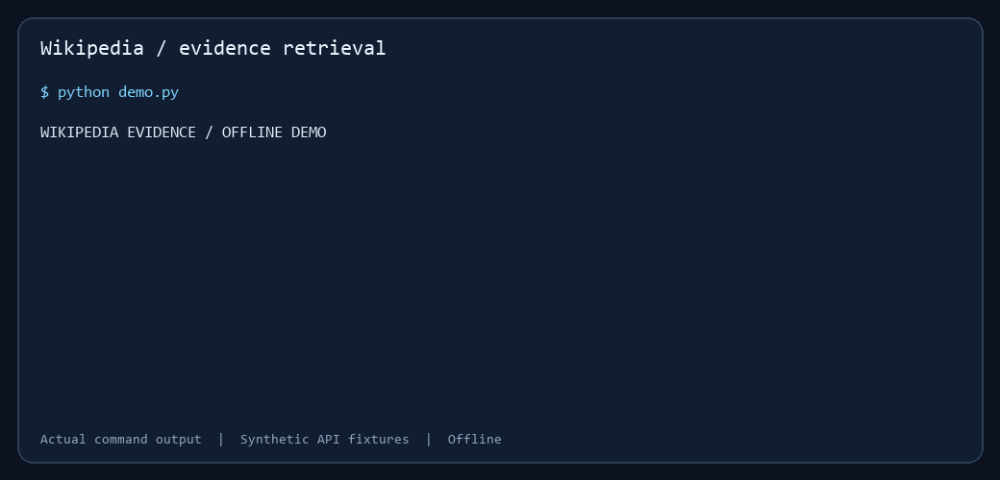
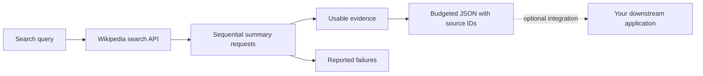

# Wikipedia Evidence Workbench

**Turn a search query into a small, source-linked context bundle.** Search English Wikipedia, retrieve article summaries, preserve Unicode and provenance, and give your next retrieval experiment a bounded input.

The runnable CLI and offline demo use **Python's standard library only**. No account, model download, API key, Azure subscription, or LLM is needed. The original Prompt Flow helpers and prompt templates remain available as integration building blocks.



The animation is rendered from real command output using synthetic API responses. It demonstrates successful retrieval, disambiguation, an unavailable source, and context truncation; it does not show a generated answer. [Recording and source hashes](docs/demo-recording.json).

## Try it in a minute

Python 3.11+; CI checks 3.11 and 3.13 on Linux and Windows.

```bash
git clone https://github.com/smgpulse007/ChatWithWiki_AzureML.git
cd ChatWithWiki_AzureML
python demo.py
python -m unittest discover -s tests -v
```

These commands are offline. There are no runtime packages to install; `requirements.txt` documents that explicitly.

For **live retrieval**, run:

```bash
python wiki_retrieval.py "Marie Curie" --limit 2 --context-chars 1600
```

This sends the query and requested article titles to Wikipedia. Use public search terms. The result is JSON containing `query`, `context.sources`, `context.omitted`, and `failures`. Each source includes a stable ID for that bundle (`S1`, `S2`, …), title, canonical URL, revision when supplied, excerpt text, and a truncation flag. IDs are assigned per invocation, not globally.

Exit codes: `0` means at least one source fit the context; `2` means invalid input or a failed search; `3` means no usable source fit. Individual summary failures appear separately, so an HTTP error cannot masquerade as retrieved evidence. Check `failures` even when the exit code is zero.

## Use it from Python

```python
from wiki_retrieval import WikiClient, build_context

documents, failures = WikiClient().retrieve("Marie Curie", limit=2)
context = build_context(documents, max_chars=1600)
print(context)  # JSON string, including source IDs and URLs
for failure in failures:
    print(failure.title, failure.reason)
```

`max_chars` budgets the **entire compact JSON string**, including escaped text and citation metadata. It is a character budget, not a token or UTF-8 byte budget. Search rank is retained; duplicate page IDs are removed after redirects. A result that cannot fit is marked omitted. Extracts are lead summaries, not full articles.



## What is bounded

| Boundary | Behavior |
| --- | --- |
| Search | 1–5 results; query length 1–500 characters |
| HTTP | HTTPS English Wikipedia API routes; same-origin redirects; descriptive User-Agent |
| Fetching | Sequential requests; 10-second socket timeout per request; 512 KiB response cap |
| Extract | At most 4,000 characters by default; configurable through Python up to 8,000 |
| Context | 256–50,000 characters; 12,000 by default; whole JSON included |
| Failures | Explicit errors, no automatic retries, response bodies kept out of diagnostics |

The socket timeout is not a whole-job deadline. Rate limits and external API availability still apply. The client follows the documented [MediaWiki search API](https://www.mediawiki.org/wiki/API:REST_API/Reference/en), [Page Content Service summary endpoint](https://www.mediawiki.org/wiki/Page_Content_Service), and [API etiquette](https://www.mediawiki.org/wiki/API:Etiquette).

## Original Prompt Flow integration

The repository started as `ChatWithWiki_AzureML`; it contains helpers and templates, not an exported Azure flow or deployed chat service.

| File | Contract |
| --- | --- |
| `get_wiki_url.py` | Query → up to five canonical Wikipedia article URLs |
| `search_result_from_url.py` | Article URLs → `(URL, summary text)` pairs |
| `process_search_result.py` | Pairs → bounded JSON context with source IDs |
| `extract_query_from_question.jinja2` | Original query-extraction prompt template |
| `augmented_chat.jinja2` | Answer prompt template requesting evidence-based citations and abstention |

In a Prompt Flow environment, its installed SDK provides the `@tool` decorator. Outside that environment, the same Python functions run without the SDK. Azure/Prompt Flow execution and model-generated answers are **not tested by this repository's CI**.

Migration notes: arbitrary URLs and `/w/index.php?search=…` URLs are no longer accepted by the retrieval helper; use the article URLs returned by `get_wiki_url`. Helper failures now raise explicit exceptions rather than returning `"No available content"`. The legacy `count` argument remains an approximate sentence cap (1–10), with punctuation and Unicode preserved. Context output changed from ad hoc text to JSON; the included answer template accepts it directly.

## Trust and scope

This is a retrieval component. It does not validate an article's truth, evaluate answer accuracy, provide a vector index, or enforce citations in generated text. Search can return different entities with similar names; inspect the titles and refine your query. Summaries may omit qualifying context, formulas, references, or details from the full article.

Retrieved text is untrusted. JSON escaping preserves structure and the template asks the model to treat evidence as data; neither guarantees resistance to prompt injection. Do not connect it to consequential tools without additional controls.

Wikipedia content has its own [reuse terms](https://en.wikipedia.org/wiki/Wikipedia:Reusing_Wikipedia_content). Preserve attribution and check those terms before redistributing excerpts. This code repository currently has **no license file**; this change does not choose a code license or grant additional reuse rights.

## Develop and reproduce the demo

Tests cover Unicode, query encoding, URL/redirect restrictions, timeouts, byte caps, malformed responses, disambiguation, partial failures, deduplication, context escaping/budgets, helper compatibility, and CLI exit statuses. The tests inject synthetic responses and never require live Wikipedia access.

To regenerate the animation, install Pillow in a disposable environment and run `python scripts/record_demo.py`. The recorder runs the real demo and test suite, stops on failure, and records source hashes. Pillow is only for rendering this documentation artifact.
